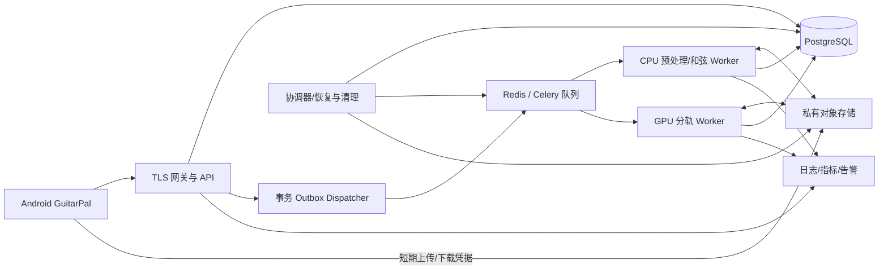

# GuitarPal 扒和弦、分轨与模型服务生产化开发规划

版本：1.0  
编写日期：2026-10-27  
现状基线：用户上传的 `development_plan.md`，更新日期 2026-10-15  
用途：交给 Codex 分阶段实施、评审和验收的增量开发规格。

> 本文没有读取 GuitarPal 源码。标为“已完成”的内容来自上传规划，不代表本次重新验证；技术栈、真实文件路径、数据表名称和播放器接口必须在 M0 对照仓库确认。本文中的接口、表名、目录、配额和性能阈值是新增设计，不是现有实现。两套上游项目用户已经实测可运行，但实测所用权重、配置及硬件尚未提供，应在 M0 固化，不能擅自替换后声称复现成功。

## 1. 产品目标与核心决策

让用户从已有练习来源进入“音频工具”，选择整曲或已有 A-B 区间，异步获取和弦时间轴或模型支持的分轨，随后在原有练习流程内定位、循环、调速、查看指法并保存片段。

首版采用以下决策：

1. **Android 客户端保留播放与练习职责，模型放到独立 Python Worker。** 不把 PyTorch、权重或 GPU 调度塞入 App，不重写已完成播放器。
2. **和弦分析与分轨可以独立运行。** 默认对原始混音分析和弦；“先分轨再分析”是可选实验，不增加所有任务的 GPU 成本，也不预设准确率一定提升。
3. **先保证二轨闭环，再按权重扩展。** 首个可用分轨配置可采用已实测的人声/伴奏权重；具体以 M0 验证为准。未验证的吉他独立轨、鼓/贝斯四轨或六轨不进入承诺。
4. **统一原媒体时间坐标。** 和弦、波形、A-B、分轨及录音相关联数据都显式描述时间映射。显示毫秒不代表模型有毫秒级识别准确率。
5. **识别结果是可编辑的练习参考。** 保留机器原始结果、修订记录与不确定状态；不输出演奏评分，不宣称自动生成可靠吉他谱。
6. **沿用本地优先体验。** 已有练习、计划、统计和录音不依赖登录或云端可用性；云端账户仅用于新增分析任务、配额和私有结果访问。
7. **生产环境以持久任务系统为准。** PostgreSQL 保存状态与版本，Celery + Redis 分发任务，对象存储保存音频。不得直接将上游演示 API 作为最终生产后端。

## 2. 已有功能、未完成事项与本次新增范围

### 2.1 已有能力：复用并回归验证

| 模块 | 基线中的已完成能力 | 本次复用方式 |
| --- | --- | --- |
| 来源导入 | Android 分享文本；B站、抖音、小红书、YouTube、普通网页识别；b23.tv 展开；本地视频导入与私有目录副本 | 在详情及播放器增加音频工具入口；引用链接不等于可取得音频 |
| 内容管理 | 本地持久化、搜索、重命名、删除、筛选、标题封面、总体笔记 | 新结果关联现有来源 ID；不复制一套曲目管理 |
| 播放练习 | 本地视频、B站 WebView；进度、音量、全屏、返回顺序、0.50x–2.00x 精确倍速 | 通过播放器适配器绑定时间轴；保持原控制逻辑 |
| A-B 与片段 | 毫秒 A/B、循环次数、片段标记、片段名称/笔记/默认倍速、保存复用 | 和弦点击/范围选择可调用现有片段创建与循环能力 |
| 计划记录 | 重复计划、提醒、自动实际播放时长与循环记录、补记、后台检查点、周/总进度 | 分轨播放只能产生一份练习会话记录，不重复累计 |
| 反馈与设置 | 14 天/12 周趋势、累计统计、浅深色主题、默认练习倍速 | 时间轴沿用主题与无障碍；新增指法图偏好 |
| 录音成果 | AAC/M4A、权限与文件管理、片段录音、试录管理、计划成果、跨日期对比、共享相对时间轴 | 支持把用户自有录音作为分析输入；不改变已有录音比较语义 |
| 导出 | 曲目及片段笔记 Markdown 导出与系统分享 | 可选择附加和弦摘要与区间，不替换笔记导出 |

### 2.2 原规划尚未完成：保持单独跟踪

- B站网页版全屏、音量、返回手势仍需 Android 真机兼容性复核。
- 其他平台 App 内播放能力仍待逐项评估；不支持时保留引用模式。
- 个人资料/头像、支持/分享/反馈尚未完成；虚拟陪伴形象仍属产品验证。
- 音频分析探索任务尚未整体完成，但已有本地 M4A 解码、波形、响度、静音占比、实验性起音间隔；不得当作空白模块重做。
- 视频参考区间节奏对齐、单音音高轨迹和复杂复音验证仍待推进。
- 原规划暂缓的 BPM 自动换算倍速、按拍/小节循环、跨设备同步继续暂缓。新模型能输出 BPM 并不自动解除这些暂缓决定。
- 原文件引用 `practice_recording_plan.md` 与 `audio_analysis_exploration.md`，本次未获得这两个附件；实施时若仓库存在，应读取并遵守已定产品语义。

### 2.3 本次新增范围与优先级

| 级别 | 范围 | 交付边界 |
| --- | --- | --- |
| P0 | 本地视频提取音频、自有音频导入、整曲/区间任务、和弦分析、任务恢复 | 视频仍用现有播放器；独立音频来源接入现有来源类型扩展点 |
| P0 | 和弦时间轴、当前/下一和弦、定位、A-B、结果离线缓存、基本修订 | 不要求节拍/小节正确，不将原曲自动生成谱面 |
| P0 | 内置和弦库、开启/关闭指法图、常见指法切换与收藏偏好 | 标准六弦 EADGBE；显示“推荐指法”，不声称还原原演奏手型 |
| P0 | 已验证配置的 BS-RoFormer 分轨、单轨独听/原曲切换、下载 | 只展示配置声明且真实产出的轨道 |
| P0 | 最小生产系统 | 鉴权、配额、队列、对象存储、删除、故障恢复、监控、部署与回滚 |
| P1 | 多轨混音台、伴奏分析实验、结果导出、批量边界编辑、手动校准 | 在 P0 真实设备与音频基准通过后做 |
| P2 | 变调/Capo 联动、更多定弦与模型、跨设备内容同步、完整节拍网格 | 单独需求；不要混入首版 |

明确不包含：网页受保护音频提取、绕过平台限制、后台录制其他 App 声音、实时边弹边识别、完整六线谱、自动演奏评分、自训练大模型、音乐公共分享市场和计费支付系统。

## 3. 上游核对与必须修正的集成风险

核对时间为 2026-10-27；以下结论来自公开仓库当时的代码，实施时按固定提交再次核实。

### 3.1 BS-RoFormer

- 库提供模型架构，不能仅实例化 `BSRoformer()` 就得到可用分轨；必须匹配训练权重、模型构造参数和推理流程。仓库说明中外链了训练/权重来源，不能把这些外链权重当成库本身自带。[来源：BS-RoFormer](https://github.com/lucidrains/BS-RoFormer/tree/84f2b25297424e93f721d5fb9d42291c6d934284)
- 输出目标由具体 checkpoint 决定。某人声权重只能承诺其训练目标；“支持多 stem 的架构”不等于该权重能分离吉他。
- 库代码标注 MIT；部署清单仍需分别记录所用权重及推理包装依赖的来源与许可信息。[来源：LICENSE](https://github.com/lucidrains/BS-RoFormer/blob/84f2b25297424e93f721d5fb9d42291c6d934284/LICENSE)

### 3.2 chord-engine

| 核对事实 | 对 GuitarPal 的影响 | 实施要求 |
| --- | --- | --- |
| 上游有异步任务接口、BTC 推理、调性/BPM/和弦分段等能力 | 可复用核心算法，但上游 API 不是 GuitarPal 协议 | 封装引擎适配器，对外只暴露自有 API |
| `api/services/job_store.py` 使用进程内字典 | 重启丢任务，多进程实例状态不共享 | 替换为数据库任务状态与持久队列 |
| `engine/loader.py` 裁剪首尾静音并丢弃裁剪索引 | 和弦可能整体相对视频提前 | 首版禁用裁剪；或补全偏移映射，禁止静默裁剪 |
| `api/services/pipeline.py` 默认请求 `use_chordmini=True` | 实际权重可能不是 README 所述标准 BTC 权重 | 固定并记录 detector 类型、词表、下载来源、SHA256 |
| 现有管线调用 `predict()`，`engine/output.py` 对缺失分段置信度设默认值 | UI 若直接显示 100% 会误导 | 缺失置信度统一 `null`；接通真实概率并测试后才展示 |
| `config.py` 区分 `N` 与 `X`，词表/标签格式存在不同表示 | 未识别与无和弦不能混为一类 | 保存 raw label，规范化时分别处理 |
| README 声称 MIT，核对根目录树未见根 LICENSE；`btc_model/LICENSE` 存在 | 许可证据不应只保存 README 徽章 | M0 记录用户已核实的授权依据、组件和权重证据；缺项仅阻止该组件发布，继续无关工作 |

源码依据：[任务存储](https://github.com/Jeremyszs/chord-engine/blob/df2c526a82b5a3df0bb9c8fbf36d4de4d659b520/api/services/job_store.py)、[音频加载](https://github.com/Jeremyszs/chord-engine/blob/df2c526a82b5a3df0bb9c8fbf36d4de4d659b520/engine/loader.py)、[管线](https://github.com/Jeremyszs/chord-engine/blob/df2c526a82b5a3df0bb9c8fbf36d4de4d659b520/api/services/pipeline.py)、[模型加载](https://github.com/Jeremyszs/chord-engine/blob/df2c526a82b5a3df0bb9c8fbf36d4de4d659b520/engine/model.py)、[输出](https://github.com/Jeremyszs/chord-engine/blob/df2c526a82b5a3df0bb9c8fbf36d4de4d659b520/engine/output.py)、[配置](https://github.com/Jeremyszs/chord-engine/blob/df2c526a82b5a3df0bb9c8fbf36d4de4d659b520/config.py)。

### 3.3 版本与制品登记

建立 `model_manifest`，每个配置记录：

```yaml
profile_id: vocals_accompaniment_v1
engine: bs_roformer
code_commit: 84f2b25297424e93f721d5fb9d42291c6d934284
checkpoint_uri: internal-registry://TO_BE_RESOLVED_IN_M0
checkpoint_sha256: TO_BE_RESOLVED_IN_M0
config_sha256: TO_BE_RESOLVED_IN_M0
targets: [vocals, accompaniment]  # 此处为拟定配置，M0 必须验证
sample_rate: null               # 由实测权重决定，不用通用值填充
channels: null
chunk_samples: null
overlap_samples: null
precision: null
estimated_vram_mb: null
license_evidence: []
enabled: false                 # 信息及基准齐全后启用
```

BTC 配置同样登记 code commit、checkpoint、词表哈希、特征采样率/hop、平滑参数与真实置信度能力。公开 API 不允许客户端传任意模型路径、下载地址或 `device=cuda`；只允许服务端白名单 profile。

## 4. 用户流程与页面入口

### 4.1 从练习来源发起

1. 来源详情和播放器更多菜单提供“分析和弦”“分离音轨”；片段菜单提供“分析这个区间”。
2. 底部面板显示输入来源、区间、需上传的大小、是否使用移动网络、预计消耗分钟与数据保留说明。
3. 用户可单选和弦、分轨，或一起执行；同时执行默认并行分支，不默认串联。
4. 本地视频仅提取所选音频上传，不传整段视频；已导入的音频与录音复用本地文件管理。
5. 提交后可继续练习或离开页面；任务中心可见排队、当前阶段、取消、重试。退出 App 后再次打开能够恢复任务查询。
6. 完成后在原来源显示“和弦”“音轨”页签；结果下载到本地后可离线使用。

### 4.2 引用平台内容的边界

- B站、YouTube 等引用来源首先判断“是否存在合法可用本地音频”。页面可播放不代表可读取媒体字节。
- 无本地文件时展示“导入对应音频后分析”，由用户选择已有本地文件；保留原引用，不新增下载/破解流程。
- 用户将外部音频绑定到引用来源时，创建独立媒体修订与时间映射，默认标为“待校准”；文件时长一致也不能证明内容相同。
- 提供两个定位锚点验证：首个明确事件和后段事件。若发现不同剪辑/变速，只能手动重新绑定或用独立音频练习；首版不做自动弹性对齐。
- B站时钟精度不满足要求时，显示“同步精度有限”，保留和弦列表定位；不可伪造精确同步。

### 4.3 分析我的录音

从录音详情发起时，输入引用录音 ID，结果时间轴默认属于该录音。原曲与录音可能存在停顿、延迟和变速，不将录音和弦直接覆盖原曲和弦。已有录音相对时间轴可用于切换回听，但分析结果跨轴使用必须有明确映射。

### 4.4 完整示例

用户在 03:00 的视频选择 00:30–00:50，发起和弦分析；结果返回该 20 秒片段的 C、G、Am、F。播放视频至 00:36 时高亮对应和弦；点击 Am 定位到原视频的相应位置；长按两个和弦将原媒体区间交给已有 A-B 控件；保存成片段并继承笔记/倍速。开启指法图后看到当前与下一和弦，切换到另一种 Am 指法不会改变识别结果或音频。

## 5. 前端和弦时间轴规格

“前端”指 GuitarPal 现有 Android UI；源码尚未确认原生/跨平台框架，不假定它是 React 网站。

### 5.1 页面布局

```text
┌──────────────────────────────────────┐
│ 原有视频/音频播放区                  │
│ 原有进度、倍速、音量、A-B 控件        │
├──────────────────────────────────────┤
│ 和弦  音轨           显示指法图 [开] │
│ 当前 Am   下一 F     调性 C大调(估计)│
│ ┌───────┐   ┌───────┐               │
│ │Am指法 │   │ F指法 │  指法 1 / 3   │
│ └───────┘   └───────┘               │
│ 00:30  C──── G─── Am──── F─── 00:50 │
│                   ↑播放位置          │
│ 自动跟随 [开]   缩放 -/+   和弦列表  │
└──────────────────────────────────────┘
```

窄屏只显示当前指法，下一和弦保留文字；关闭指法图后移除图形区域并保留名称和时间轴，避免占据练习画面。横屏/全屏使用可折叠底部层，不能破坏现有全屏自动隐藏与返回键顺序。

### 5.2 时间轴交互

| 操作 | 行为 |
| --- | --- |
| 播放 | 当前分段按 `start_ms <= position < end_ms` 高亮；间隙或未知状态不延续上一和弦 |
| 单击块 | 请求播放器 seek 到块起点；不自动播放已暂停媒体 |
| 长按或菜单“选择范围” | 进入选择模式，选择起止块，确认后调用现有 A-B API；不抢占普通横向滚动 |
| 横向滚动 | 关闭临时自动跟随，显示“回到播放位置”；点击后恢复 |
| 缩放 | P0 提供 +/-，P1 可加双指缩放；以当前播放点或选中块为锚 |
| 切换列表 | 显示起止时间、和弦、可选 Roman numeral、不确定标记；列表与时间轴共享选择 |
| 点击当前和弦 | 展开详情：原始标签、修订状态、指法列表；P0 支持改名与恢复机器结果 |
| 从任务返回 | 恢复来源、区间、显示偏好；不打断已有正在播放的来源 |

渲染按时间比例安排块宽度，但短块可以只画窄条、将名称放入详情。点击区域至少达到平台建议触控尺寸，短块重叠时通过列表或放大选择，不能用扩大显示宽度改变语义边界。

### 5.3 信息语义

- `C:maj` → `C`，`A:min` → `Am`，`G:7` → `G7`；保留 `raw_label`，未知扩展标签显示原文。
- `N` 显示“无和弦”，`X` 显示“未知”，不把未知当静音；两者均不推荐指法。
- 模型概率不可作为准确率。只有具有真实来源和明确聚合方法的分数可显示“模型置信度”；缺失时不显示百分比。
- 低置信度阈值初始设为可配置的 0.6，仅在真实概率接通后启用；样式用虚线/图标/文字组合，不能只靠颜色。
- 调性和 BPM 带“估计”；不可靠时 `null`，不能用 120 BPM 作为静默兜底。首版不显示未经验证的小节线或拍号。
- 结果标注“整段音乐的和声参考”，不声称识别出了吉他当前按法。

### 5.4 播放器时钟适配

建议抽象以下能力，名称按真实仓库调整：

```text
PracticeClock
  positionMs, durationMs, speed, isPlaying
  seekTo(ms), setLoop(aMs, bMs), setSpeed(speed)
  capabilities: preciseSeek, clockResolutionMs, externalAudioSync
```

- 本地播放器为音视频主时钟；前台 50–100ms 刷新 UI，用有序分段二分查找，避免每帧全表扫描。
- 倍速播放直接读取原媒体位置，不用墙上经过时间计算和弦位置。0.5x、1x、2x 不改变 `start_ms/end_ms`。
- A-B 回跳、拖动、暂停、切全屏、重建 Surface、进后台和恢复时重新读取主时钟。
- 和弦选区进入已有片段编辑器，不新增平行的循环存储。
- WebView 通过现有安全桥接获取有限的播放状态；不扩大任意 JS 调用权限。

### 5.5 编辑、离线与无障碍

- P0：修改某段和弦标签、撤销当前修改、恢复机器版本；修改存入独立 revision。
- P1：拖动边界、合并/拆分、批量替换。边界编辑必须验证单调、不交叠、不超出分析区间。
- 服务端结果和已确认修订本地落盘，断网可浏览、指法查询和播放已下载音轨；未下载文件提示联网下载。
- 任务失败、无声、未知和弦、库无指法、结果已过期、文件丢失、同步待校准分别给出明确状态。
- 读屏示例：“A 小调，30.250 秒到 34.800 秒，已人工修改”；指法图提供逐弦文字说明。大字体不能裁掉核心操作。

## 6. 和弦库、可切换指法与音名规则

### 6.1 数据来源与导入方式

优先候选为 `tombatossals/chords-db` 的构建后 `lib/guitar.json`。它提供和弦多指法与标准定弦数据，仓库含 MIT LICENSE。使用固定版本，保留来源与署名；无需在 Android 中运行其 JavaScript 构建工具，也不要求引入 React 渲染组件。[数据](https://github.com/tombatossals/chords-db/blob/df06fa7b425cf5fd29485ff6591236b3557e3fac/lib/guitar.json)、[许可](https://github.com/tombatossals/chords-db/blob/df06fa7b425cf5fd29485ff6591236b3557e3fac/LICENSE)

MVP 的“导入和弦库”指开发侧将固定数据转换为 App 内置离线资源。P1 可提供用户导入规范 JSON 的入口，需预览、校验、合并/替换选择和一键回滚；不执行导入文件中的脚本。首次上线不依赖第三方运行时在线查询。

转换步骤：

1. 固定库提交与文件校验和，记录第三方清单。
2. 统一 root、quality、bass、tuning，构建别名表和按根音/类型索引。
3. 将源 `baseFret` 与相对品位换成规范的绝对品位；源数据中 `capo` 是绘图/横按相关标记，不能直接解释为用户使用了变调夹。
4. 校验六弦长度、指号范围、品位、横按端点及 MIDI 音高；抽查 C、Am、F、Bm 和高把位和弦，防止弦序镜像。
5. 输出版本化 JSON/SQLite 资源与覆盖报告；在当前 UI 框架内绘制指法图，避免为此更换技术栈。

### 6.2 规范数据结构

```json
{
  "schema_version": 1,
  "voicing_id": "std-C-maj-open-1",
  "chord_key": "C:maj",
  "root_pc": 0,
  "quality": "maj",
  "bass_pc": null,
  "tuning_midi": [40, 45, 50, 55, 59, 64],
  "string_order": "low_to_high",
  "frets": [-1, 3, 2, 0, 1, 0],
  "fingers": [null, 3, 2, null, 1, null],
  "display_base_fret": 1,
  "barres": [],
  "tags": ["open", "beginner"],
  "difficulty": "easy",
  "source_library": "chords-db",
  "source_version": "df06fa7b425cf5fd29485ff6591236b3557e3fac"
}
```

规范 `frets`：从低音 E 到高音 e；`-1` 为不弹、`0` 为空弦、正数为绝对品位。图中默认左侧低音弦，上方琴枕；高把位标起始品。横按规范为 `{fret, from_string, to_string, finger}`，弦编号 0–5，禁止只保存一个含糊的 barre 数字。

### 6.3 指法选择和偏好

转换器至少提供下列别名表，并以导入库的实际 suffix 集合做覆盖校验；表中“候选”不是保证存在的条目：

| 模型规范 quality | 指法库候选 suffix | 显示示例 |
| --- | --- | --- |
| `maj` / 裸根音 | `major` | C |
| `min` | `minor` | Cm |
| `7`、`maj7`、`min7` | `7`、`maj7`、`m7` | C7 / Cmaj7 / Cm7 |
| `dim`、`dim7`、`hdim7` | `dim`、`dim7`、`m7b5` | Cdim / Cdim7 / Cm7♭5 |
| `aug`、`sus2`、`sus4` | `aug`、`sus2`、`sus4` | Caug / Csus2 / Csus4 |
| `maj6`、`min6`、`minmaj7` | `6`、`m6`、`mmaj7` | C6 / Cm6 / Cm(maj7) |

解析不能依赖显示字符串拼接。导入报告逐项输出“精确匹配/等音匹配/仅可简化/无数据”，为每个启用模型词表生成覆盖率，尤其验证半减七、增和弦、转位与库中大小写规则。

- “显示指法图”是全局本地持久偏好，默认关闭；首次出现结果提供轻提示。用户开启后后续来源沿用。
- 每个和弦默认展示按标签和可演奏性筛选的推荐指法，左右切换，并显示“1/4”“开放和弦/横按/高把位”。
- 初学者优先排序：较少横按、较小跨度、较低把位、较少按弦；这是推荐排序，不是客观难度评分。复杂类型无简单指法时明确告知。
- 针对标准定弦记忆用户选中的 `voicing_id`，以 `(chord_key, tuning)` 为键；库升级找不到该 ID 时回退默认，不能崩溃。
- 左手模式只镜像显示，不改变音乐数据弦序；所有图形提供空弦圈、不弹叉、指号和横按。
- 无精确指法时显示“暂未收录”；允许显式选择“查看简化和弦”，例如 Cmaj7 简化 C，但必须显示“简化参考”，不替换原识别标签。

### 6.4 转位、等音与 Capo 边界

- 数据层用 pitch class 计算，显示层保留原拼写与调性偏好；C# 与 Db 可共享音高索引，但不要丢失原音名。
- 斜杠和弦保留实际 bass，例如 C/E；没有对应低音的指法不能伪装成精确匹配。
- 首版无自动移调或 Capo。以后若增加，分开保存 `sounding_chord`、`shape_chord`、`capo_fret` 和音频变调半音数；例如实响 D、Capo 2、C 手型应三者分别显示。
- 播放变速是否保持音高以现有播放器能力为准；M0 记录。指法不得因为变速被无意移调。

## 7. 分轨播放与已有练习系统的衔接

### 7.1 P0 单轨回听

- 结果显示原曲、配置声明的实际轨道、各自大小及下载状态；允许选择一个音轨独听、切回原曲、下载/删除本地副本。
- 本地视频画面继续由现有播放器承载；切到分轨时原视频音量静音，新音轨跟随原视频主时钟。失败时可恢复原声，不丢失片段、倍速和练习记录。
- 只有 `externalAudioSync=true` 的播放器开放同步外部音轨。B站 WebView 首版不承诺可靠的外部混音，可在独立音频模式练习并保留来源链接。
- P0 允许实现“外部音轨跟随主视频”的切换播放器；切换短暂缓冲可接受，但不得出现双声。音轨未准备好前不切断可用音频。

### 7.2 P1 多轨混音

优先用同一个音频渲染时钟和混音管线，同时解码多轨并调节增益/静音/独听；不要将多个独立播放器的开始时间相同当作长期同步保证。所有 stem 共享采样数、采样率和起点，变速只应用一次。

进入多轨模式后总音量沿用现有控制，各轨音量额外管理，避免总增益削波。独听、静音和当前所选轨只影响回听，不改变分析原始输入。计划记录仍从统一 `PracticeSession` 记一次，录音是否同时收录外放声音仍按现有麦克风录音行为说明。

### 7.3 同步和缓存验收

- 每个 stem manifest 包含 `duration_ms`、`sample_rate`、`sample_count`、`channels`、`offset_samples`、校验和和媒体修订 ID。
- 解码到共同 PCM 基准后对齐，不能仅比较有损文件的容器时长；AAC/MP3 编码延迟需实测补偿，首版下载母版优先 FLAC。
- 本地视频 P0 目标：连续播放 5 分钟后分轨与画面偏差 ≤80ms；seek/A-B 回跳后 500ms 内收敛至该范围。达不到时先修播放器适配，不能关闭计时验证。
- 长曲用磁盘文件/流式解码；不能一次把整曲所有 stem 解码进 Android 内存。后台缓存下载用平台可靠任务机制，界面退出后可恢复。

## 8. 媒体预处理与全链路时间协议

### 8.1 输入约束与初始配置

| 项 | 首版拟定限制 | 校验位置 |
| --- | --- | --- |
| 分析时长 | 2 秒–10 分钟；更长来源可选区间 | 客户端提示、服务端解码后强校验 |
| 上传大小 | 100 MiB；可配置 | 签名/代理限制、完成上传后再次检查 |
| 输入 | WAV、FLAC、MP3、M4A、OGG 的受支持音频编码 | 真实容器/解码检测，不只看扩展名 |
| 视频 | 客户端从本地视频提取音频 | 服务端首版不接视频文件 |
| 声道 | 规范化为模型所需单/双声道；拒绝未定义布局 | CPU 预处理 |
| 默认上传 | 尽量保留可用音频质量；已是有损音频避免重复低码率压缩 | Android 媒体适配 |

Android 优先复用已有解码和音频文件能力，按项目技术栈选择系统媒体接口或成熟组件，不为方便默认引入大型 FFmpeg 二进制。服务端使用受限 FFmpeg/ffprobe 子进程统一解码。两处都要保留提取区间的实际起点；有损流 copy 或关键帧 seek 若不精确，不能谎报精确裁切。

### 8.2 时间轴定义

统一外部时间单位为整数毫秒，区间采用左闭右开 `[start_ms, end_ms)`；音频内部采用样本数，采样率转换后只在边界做一次确定性舍入。

定义：

- `source_time`：原始媒体的内容位置，倍速不改变它。
- `input_time`：上传区间音频的位置，从 0 开始。
- `engine_time`：引擎实际接收音频的位置，可能有首部裁剪。
- `source_offset_ms`：上传音频 0 对应的原媒体位置。
- `trim_start_ms`：引擎裁剪的首部时长，首版强制 0。
- `user_alignment_ms`：用户针对外部绑定音频的人工校准偏移，默认 0，独立保存。

同速、同剪辑的映射：

```text
source_time_ms = engine_time_ms + trim_start_ms + source_offset_ms
display_source_time_ms = source_time_ms + user_alignment_ms
```

例如：分析原媒体 30–50 秒，引擎裁掉 1.2 秒静音，输出某段起点 2 秒，则原媒体起点是 33.2 秒；不能直接当作 2 秒或 32 秒。首版禁用裁剪后该段应相对完整输入返回时间。若人工偏移使边界超出来源，UI 显示越界提示，不静默改写机器结果。

服务端返回的 `segments` 已经转换到 **原媒体坐标**，客户端不得再加 `source_offset_ms`。原始引擎相对结果单独存于诊断制品。`coverage` 表示本次实际分析区间，区间以外是“未分析”，不能填成“无和弦”。

### 8.3 和弦预处理与边界

- 禁用上游静默裁剪；保留首尾无声区，或明确补 `N`。全静音输入返回可理解结果或 `NO_USABLE_AUDIO`，不返回虚构 C 大调。
- 用 checkpoint 要求的特征采样率与 hop，不能假设所有 BTC 变体共享参数。
- 检查特征帧居中、padding、尾帧裁切、拼接和 beat snapping；补齐整除 timestep 的测试，防止尾部有效帧被当成 padding 丢弃。
- 可保留未吸附和吸附后边界，默认先验证原始时间；节拍吸附不应改变和弦顺序、导致零长段或伪造小节。
- 分段规则版本化：同标签连续合并、最短段阈值、平滑算法与参数写入结果元数据。原始帧预测可按需保存短期诊断，不默认下载到客户端。

### 8.4 分轨推理

- 在模型要求采样率上分块并做 overlap-add，padding 后恢复原始有效样本数；块长、重叠、精度从已验证 profile 读取。
- 不对每个 chunk 或每个 stem 独立响度归一化，否则音量与重组关系会被破坏；如需试听增益仅在播放层应用。
- 二轨配置若用 `accompaniment = mixture - vocals`，必须在同采样率、长度、增益和相位下计算，并将派生方法写入 manifest。
- 输出检查：目标数量、样本数、无 NaN/Inf、无非预期全静音、峰值/削波比例、拼接边界。不能靠文件存在判成功。
- 显存不足仅允许一次已验证的小 chunk 配置重试；记录变化。没有经过基准验证的 CPU 分轨回退不自动开启。

## 9. 模型适配器与分析策略

### 9.1 适配器契约

```text
SeparationEngine
  load(profile)
  separate(input_pcm, output_dir, cancellation, report_progress) -> StemManifest
  health() -> model_hash / device / ready

ChordEngine
  load(profile)
  analyze(input_pcm, options, cancellation, report_progress) -> RawChordResult
  normalize(raw_result, media_mapping) -> ChordAnalysisV1
```

适配器负责版本固定、输入输出校验、时间与标签规范化；任务生命周期、鉴权、配额、上传/下载链接全部由平台服务负责。不要在上游全局 `job_store` 中存自有任务，不要用抓取日志文本模拟稳定的结果协议。

### 9.2 和弦策略

| 模式 | 输入与依赖 | 默认行为 |
| --- | --- | --- |
| `original` | 规范化原始混音 | P0 默认；可独立运行 |
| `accompaniment_experimental` | 成功的指定分轨结果 | P1；界面明确实验性质并记录额外成本 |
| `compare` | original 与 accompaniment 各运行一次 | 内部评估使用，保存为两个独立结果，不静默覆盖 |

分轨可能减少人声干扰，也可能破坏和声信息；是否更好以固定标注集实测决定。如果前置分轨失败，实验分支标记失败，用户可以显式新建原曲分析；已完成原曲结果保持可用。

### 9.3 输出验证

- confidence 来自真实帧概率时，按分段覆盖时间加权聚合，保存 `confidence_method`；只输出标签的 detector 返回 `null`。
- 保留 `raw_label`、规范标签、词表版本、源类型与机器/人工来源；未知映射不得丢段。
- 对输出做 schema 校验和边界检查。无效输出是失败，不由前端“猜着修复”。
- 权重加载后一次预热；进程内复用模型，不每个请求重复加载，也不混用设备不同的单例。

## 10. 生产架构与部署边界

### 10.1 推荐的首个生产拓扑



- **API**：FastAPI，处理授权、上传会话、任务编排、结果访问、删除与配额，不在 Web 进程内推理。
- **CPU Worker**：探测/解码、波形摘要、BTC 基线分析、导出与清理；BTC 是否改用 GPU 依据实测成本。
- **GPU Worker**：BS-RoFormer，每 GPU 首版最多一个活动推理任务，按 profile 预热。
- **PostgreSQL**：任务/步骤/版本/权限/用量的唯一事实源。Celery result backend 不能替代业务数据库。
- **Redis**：队列与短期限流状态，独立持久卷、认证、私网。启用持久化，数据库协调器仍需能补发丢失任务。
- **对象存储**：S3 兼容服务；本地开发可用 MinIO，生产选目标区域服务。大音频不写 PostgreSQL，不经过 API 全量转发。

### 10.2 从开发到生产

| 环境 | 配置 | 目标 |
| --- | --- | --- |
| 本地开发 | Compose：API、Postgres、Redis、MinIO、CPU Worker；GPU 可远端连接；fake engine 仅测试 | 契约联调与恢复演练 |
| 小规模私测 | 一台 CPU 服务 + 一台 GPU Worker，私有存储，TLS，备份，最小可用监控 | 完成真实上传/推理/离线播放闭环；可接受单机可用性限制 |
| 对外生产 | API 多副本、托管或高可用数据库/Redis、独立 GPU 池、集中监控、IaC | 按实际流量扩缩；升级可回滚 |

首版不强制 Kubernetes、Triton、Ray Serve；先用可审查容器与明确进程职责。GPU 规模、调度和模型数量出现实际需求后再引入。Docker Compose 私测拓扑不宣称高可用。

## 11. 任务队列、状态机与故障语义

### 11.1 DAG 和状态

标准 DAG：`validate_media -> preprocess -> [chords_original, separate] -> publish_result`。两个分支独立成功；实验性伴奏分析另加 `separate -> chords_accompaniment` 依赖。

```text
created -> queued -> running -> succeeded
                       |      -> partially_succeeded
                       |      -> failed
                       -> cancel_requested -> canceled
created/queued -> canceled
running -> retry_wait -> queued
```

音频尚未上传完成由 `media_asset.upload_state` 表示，只有 `ready` 资产可建任务。每个 step 独立有 `queued/running/succeeded/failed/canceled/skipped`、attempt 与状态版本。

- 请求了两分支，仅和弦成功时：父任务为 `partially_succeeded`，成功结果可用，失败分支可单独重试。
- `succeeded` 表示所有请求的步骤和制品均已提交且验证通过；`progress=100` 仅在成功终态显示。
- 取消与失败是不同状态。已保存的成功分支不因另一个分支取消而删除，保留策略按用户选择。
- 进度分阶段展示；分块推理可以报真实 chunk 进度，不确定时显示阶段与活动提示，不每秒虚增百分比或承诺 ETA。

### 11.2 可靠投递与幂等

1. API 事务中写入 job、steps、配额预留和 outbox event，一起提交。
2. dispatcher 发布只含 `step_id` 的 JSON 消息，发布成功后标 outbox；重复发布可接受。
3. Worker 从数据库条件更新领取 step，获取 `lease_token` 和 `lease_expires_at`；领取失败或已完成直接退出。
4. heartbeat 每 15 秒续租，初始租约 90 秒；协调器每 30 秒扫描过期租约。活跃租约的任务不被重复执行。
5. 输出先写 attempt 独立临时对象，校验后由持有有效 lease 的 Worker 在事务中登记 artifact、结果和用量，再标成功。
6. 失去 lease 或遇删除标记的旧 Worker不能发布结果。已上传的孤儿对象由清理器回收。
7. DB commit 后才确认队列消息；若确认丢失，重投仅查询到已完成并退出，不重新扣配额。
8. 定时对照数据库补发“queued 但无进展”的步骤；Redis 丢数据时通过步骤幂等恢复。

Celery 的 `acks_late` 只是一部分可靠性措施；还要配置实际执行时限、Redis visibility timeout、预取和故障回收。官方说明提示某些进程终止即使 late ack 仍可能确认消息，不能单靠 ack 选项承诺恢复。[Celery 任务文档](https://docs.celeryq.dev/en/stable/userguide/tasks.html)

### 11.3 取消、重试和超时

| 情况 | 策略 |
| --- | --- |
| 网络/存储临时故障 | 初始最多 3 次总尝试，退避 10s/30s 并加抖动；上限配置化 |
| Worker 丢失 | 失租后重新排队；计入总 attempt 上限，防死循环 |
| GPU OOM | 一次经验证的小 chunk fallback；仍失败返回 `MODEL_RESOURCE_EXHAUSTED` |
| 损坏音频/超时长/不支持模型/无权限 | 不重试；给可操作错误 |
| 推理挂起 | chunk 间检查取消；I/O 自带超时；软超时后收尾，硬超时杀该工作子进程并重建模型 |
| 用户取消 | queued 原子置 canceled；running 置 cancel_requested，安全边界退出；超过宽限时间隔离终止该任务进程 |
| API 重启 | 不影响已排队或运行任务；App 继续按 job ID 查询 |

初始步骤硬上限：预处理 5 分钟、和弦 10 分钟、分轨 20 分钟；M0 用目标硬件与最长输入验证并调整，必须给 Redis visibility timeout 留出运行与收尾余量。GPU 采用独立任务子进程或常驻服务加隔离执行设计，不能无差别杀掉同机其他用户任务。

### 11.4 客户端恢复

提交前本地保存 client request ID，服务端接受 `Idempotency-Key`，唯一范围 `(owner_id, route, key)`；相同 key 相同请求返回原任务，不同请求体返回 409。App 启动恢复非终态任务；轮询初始 2 秒、后台/无变化逐步退避到 15–30 秒，遇 429 按 `Retry-After`。P1 可加 SSE，断线仍用查询补齐，推送不作为唯一真相。

## 12. 对象存储、缓存、删除与隐私

### 12.1 数据分类与拟定生命周期

| 数据 | 首版默认保留 | 删除方式 |
| --- | --- | --- |
| 未完成上传/分片 | 24 小时 | upload session 到期与存储生命周期清理 |
| 上传原音频 | 任务结束后 24 小时，且从上传起最多 7 天 | 活跃 lease 期间保护；到最大保留期先终止任务再清理 |
| Worker 临时 PCM/chunk | 任务完成/失败后立即；异常残留最长 24 小时 | finally + 宿主定期清扫 |
| 分轨文件 | 30 天 | 到期前提示下载；可按产品设置更短 |
| 和弦 JSON/用户修订 | 账户存续期间，用户可主动删除 | 与来源绑定删除或单独删除 |
| 运行日志 | 14 天 | 不记录音频、访问令牌、完整签名 URL |
| 脱敏汇总用量 | 90 天 | 保留聚合统计，删除内容关联 |
| 本地下载与结果 | 用户管理；缓存可设上限 | 显示占用、逐项删除；私有目录 |

这些数值是产品默认提案，写入配置和用户可见说明；上线前确认实际存储区域及留存选择，不把短期缓存宣传成永久云盘。

### 12.2 上传/下载

- 服务端生成随机对象 key：`tenant/{owner_id}/assets/{asset_id}/...`，原始文件名只作为经过清理的显示字段。
- 上传凭据有效期拟定 15 分钟；限制单一对象、方法、校验和。支持条件约束的 POST policy 时加入大小限制；PUT 签名不能代替上传完成后的真实大小/格式检查。
- 完成上传后转成不可变资产：复制/固定对象版本，或使用可验证的一次写入策略。签名 URL 在到期前可重复使用，不能假设“完成”就阻止覆盖。
- 下载凭据有效期拟定 5 分钟；每次签发先做 owner 检查。URL 过期后客户端用 artifact ID 请求新 URL，数据库只存 key，不存签名 URL。
- 私有桶默认拒绝公共访问；传输 TLS，服务端加密；支持 Range 的音频下载要验证实际客户端续传和签名刷新。

S3 官方资料明确签名 URL 在有效期内可多次使用，同 key 上传可能替换对象，因此需要上述不可变资产步骤。[S3 预签名 URL](https://docs.aws.amazon.com/AmazonS3/latest/userguide/using-presigned-url.html)

### 12.3 缓存与删除竞态

缓存 key 至少包含：owner、服务端验证的内容哈希、精确分析区间、预处理版本、模型/权重/配置哈希、平滑参数、输入轨道、输出格式。首版只做同账户复用，避免跨用户哈希命中泄露内容是否存在。引用型“同一 URL”不是内容哈希。

删除操作先写 tombstone、撤销后续签发与取消任务，再异步删除对象和 DB 内容；旧 Worker 提交时必须检查 tombstone，避免“删除后又复活”。已发出的短期 URL 可能在到期前仍有效；需要更快撤销时使用带鉴权代理或对应存储策略，不能对用户承诺不存在的即时撤销。

云端内容拟定在删除请求后 24 小时内清除；备份中的内容在最长 30 天滚动周期淘汰，恢复时重放删除标记。下载到其他设备或用户导出的文件不受云端删除控制。默认不将用户音频用于训练，不将真实音乐文件写入错误追踪附件。

## 13. 鉴权、安全与资源保护

### 13.1 账户与授权

- 本地模式不要求注册；开始云分析时才进入最小账户登录。可接入托管 OIDC，移动端用 Authorization Code + PKCE；已有身份服务存在时优先复用。
- API 验证令牌签名、issuer、audience、过期与 scope；把稳定 `sub` 映射到内部 owner ID，不信任请求体的 owner ID。
- App refresh token 存平台安全存储，API/存储密钥绝不打包进 App。测试版凭据也不得写入源码。
- 每个 asset、job、artifact、revision、签名 URL 请求均做对象级授权；UUID 难猜不能替代权限检查。
- Worker/API 用服务身份和最小权限访问数据库与桶，生产数据库和 Redis 不暴露公网；管理操作单独授权并审计。

### 13.2 上传与运行安全

- 服务端不接受任意媒体 URL，不直接开放上游 YouTube 下载入口；降低 SSRF 与平台媒体获取问题。
- 按真实字节/容器、解码后时长、样本数和声道检查，限制压缩后很小但解码后超大的输入。
- FFmpeg 参数使用数组调用，不拼 shell；白名单 codec/protocol，运行在无特权容器，限制 CPU/RAM/磁盘/进程/时限及出站网络。
- 权重仅从受控制品库读取并验证哈希，禁止用户上传 checkpoint，避免不可信反序列化。推理依赖锁版本，镜像做漏洞扫描和组件清单。
- JSON 导入限大小、结构深度、和弦/指法条数；不允许任意文件路径、URL 下载或脚本执行。
- 脱敏日志记录 request/job/step ID、模型版本、耗时、错误码；不记录音频内容、完整文件路径、原访问凭据。
- 浏览器调试工具若存在，CORS 只允许明确来源；CORS 不能作为 Android API 鉴权。

### 13.3 配额与公平性

私测初始配置：每账户同时最多 2 个未完成任务、最多 1 个活跃分轨；每日和弦分析 60 音频分钟、分轨 20 音频分钟。匿名只允许本地功能。所有值经配置下发，不硬编码到多个客户端页面。

服务端对身份、IP、上传会话与任务创建分别限流，按预估时长预留配额，解码后重新核对实际时长。用量唯一约束防止重试重复扣费；平台失败释放用户配额，但实际 GPU 消耗仍计入内部成本。原曲与分轨缓存命中按策略减少用量，规则对用户可见。预计等待超过配置阈值时暂停新分轨或提示稍后，不无限堆积昂贵任务。

## 14. 对外 API 契约（GuitarPal 自有 `/v1`）

以下为拟定协议，不等同于 chord-engine 上游 `/api/v1`。统一 JSON UTF-8，时间 ms、UTC RFC3339；客户端显示采用用户时区。公开 API ID 使用不透明 UUID；不返回服务器文件路径。

### 14.1 端点

| 方法与路径 | 作用 | 关键约定 |
| --- | --- | --- |
| `GET /v1/capabilities` | profile、限制、功能开关与库版本 | 仅返回 enabled 配置，不暴露内部地址 |
| `GET /v1/me/usage` | 配额、剩余额度和预留用量 | 账户鉴权 |
| `POST /v1/uploads` | 创建上传会话 | `Idempotency-Key`；返回 asset/upload ID 和受限凭据 |
| `GET /v1/uploads/{id}` | 查询上传会话 | 恢复中断，不默认支持任意分片协议 |
| `POST /v1/uploads/{id}/complete` | 校验并固定不可变媒体 | 可重复；返回资产验证状态；后续由 `GET assets` 查询 |
| `POST /v1/uploads/{id}/abort` | 中止上传 | 幂等，清理残留 |
| `GET /v1/assets/{id}` | 获取媒体验证状态/时长 | `pending/validating/ready/rejected/deleting/deleted` |
| `POST /v1/jobs` | 提交分析 | 资产 ready；原子预留配额；202 |
| `GET /v1/jobs?cursor=...` | 当前用户任务列表 | 游标分页，返回 next_cursor |
| `GET /v1/jobs/{id}` | 阶段、分支、结果引用、失败原因 | 客户端断线恢复的主接口 |
| `POST /v1/jobs/{id}/cancel` | 取消 | 幂等；终态不回退 |
| `POST /v1/jobs/{id}/retry` | 重试指定失败分支 | 新 job 引用 parent_job，复用合格制品 |
| `GET /v1/jobs/{id}/result` | 获取结构化结果 manifest | 非终态 409；部分成功含可用结果 |
| `GET /v1/analyses/{id}` | 读取机器结果与当前修订 | ETag/版本 |
| `PUT /v1/analyses/{id}/revisions` | 保存完整编辑后分段快照 | `If-Match` 乐观锁，冲突 412 |
| `POST /v1/artifacts/{id}/download-url` | 授权下载 | 短期 URL 与 expires_at |
| `DELETE /v1/jobs/{id}` | 删除该任务结果 | tombstone；不误删被其他任务引用资产 |
| `DELETE /v1/assets/{id}` | 删除媒体及其派生内容 | 响应列出受影响 job，遵循删除协议 |
| `GET /health/live`、`GET /health/ready` | 基础设施探针 | readiness 不允许泄露数据库凭据 |

和弦库首版随 App 内置，不要求 API。P1 远程更新只分发经过验证、带哈希和版本的资源包。

### 14.2 创建上传会话

```json
{
  "display_name": "练习曲片段.flac",
  "content_type": "audio/flac",
  "size_bytes": 3800000,
  "sha256": "<客户端校验和，服务端仍须验证>",
  "client_source_id": "<本地来源UUID>",
  "client_media_revision_id": "<本地媒体修订UUID>",
  "mapping": {
    "source_offset_ms": 30000,
    "source_duration_ms": 180000,
    "input_duration_ms": 20000,
    "alignment_status": "exact_extraction"
  }
}
```

这些时长为客户端声明，服务端解码后保存 verified duration；服务端不能验证本地原视频完整时长时注明来源，不伪称已验证原媒体。响应包含 `upload_id`、`asset_id`、上传方式/必要 headers、`expires_at`、`complete_url`。长文件续传 P1 可扩展 multipart，需单独定义 part 列表与完成校验。

### 14.3 创建任务

```json
{
  "asset_id": "<asset UUID>",
  "operations": {
    "chords": {"profile_id": "btc_fixed_v1", "input": "original", "smoothing": "hmm"},
    "separation": {"profile_id": "vocals_accompaniment_v1"}
  },
  "client_request_id": "<UUID>"
}
```

不请求某功能就省略该 operation。输入 asset 已是所选区间，任务不得把 30–50 秒再次裁切一次。profile 的真实名称 M0 冻结。

```json
{
  "job_id": "<UUID>",
  "status": "queued",
  "status_url": "/v1/jobs/<UUID>",
  "reserved_usage": {"chord_audio_ms": 20000, "separation_audio_ms": 20000},
  "created_at": "2026-10-27T09:00:00Z"
}
```

### 14.4 结果主结构

```json
{
  "schema_version": 1,
  "job_id": "<UUID>",
  "status": "partially_succeeded",
  "asset_id": "<UUID>",
  "media_revision_id": "<UUID>",
  "timebase": "source_media_ms",
  "coverage": {"start_ms": 30000, "end_ms": 50000},
  "mapping": {"source_offset_ms": 30000, "trim_start_ms": 0},
  "chords": {
    "analysis_id": "<UUID>",
    "revision": 1,
    "profile_id": "btc_fixed_v1",
    "input_kind": "original",
    "key": {"label": "C major", "confidence": null},
    "tempo": {"bpm": 119.8, "confidence": null},
    "confidence_method": null,
    "segments": [
      {"id": "s1", "start_ms": 30000, "end_ms": 40000, "raw_label": "C", "chord_key": "C:maj", "display_label": "C", "roman": "I", "confidence": null, "origin": "machine"},
      {"id": "s2", "start_ms": 40000, "end_ms": 50000, "raw_label": "A:min", "chord_key": "A:min", "display_label": "Am", "roman": "vi", "confidence": null, "origin": "machine"}
    ],
    "provenance": {"code_commit": "<SHA>", "checkpoint_sha256": "<SHA256>", "preprocess_version": "p1", "postprocess_version": "hmm1", "vocabulary_hash": "<SHA256>"}
  },
  "separation": {"status": "failed", "error_code": "MODEL_RESOURCE_EXHAUSTED", "artifacts": []},
  "warnings": ["CHORD_CONFIDENCE_UNAVAILABLE"]
}
```

这是协议示例，不是真实识别结果。成功 stem artifact 返回 `id/role/format/size_bytes/sha256/sample_rate/sample_count/channels/offset_samples/coverage`。波形只返回多级 peaks artifact，不把完整 PCM 嵌入 JSON。诊断原始数据不通过默认结果接口下发。

### 14.5 错误与并发修订

统一错误格式：

```json
{
  "error": {
    "code": "QUOTA_EXCEEDED",
    "message": "今日分轨额度不足，请缩短区间或稍后再试。",
    "retryable": false,
    "request_id": "<UUID>",
    "details": {"remaining_audio_ms": 10000}
  }
}
```

401 未登录/过期，403 无权限，跨账户资源可统一 404，409 状态/幂等冲突，412 修订冲突，413 过大，415 编码不支持，422 结构或音频无效，429 限流，503 容量暂不可用。后台推理失败体现在 job 的错误码，不把所有失败都转成 HTTP 500。

客户端修订离线先存 local draft，联网通过 `If-Match` 保存。出现冲突显示两个版本与用户选择，不能用最新下载的机器结果静默覆盖人工编辑。重新分析创建新 analysis，旧修订保留并可切换。

## 15. 数据库设计与客户端迁移

### 15.1 服务端核心实体

| 表 | 关键字段 | 约束/索引 |
| --- | --- | --- |
| `users` | id, auth_issuer, auth_subject, created_at, deleted_at | unique(issuer, subject) |
| `media_assets` | id, owner_id, client_source_id, client_media_revision_id, object_key/version, verified_sha256, verified_duration_ms, source_offset_ms, upload_state, retention_deadline, deleted_at | owner+created；ready 前不允许任务；对象不可变 |
| `upload_sessions` | id, asset_id, expected_size/checksum, expires_at, status | 唯一 asset 关联；过期扫描 |
| `jobs` | id, owner_id, asset_id, parent_job_id, requested_operations, status, state_version, canceled_at, deleted_at, created/started/finished_at | owner+created；status+updated |
| `job_steps` | id, job_id, kind, profile_id, status, attempt, progress, lease_token/expires_at, error_code, input_fingerprint | unique(job_id, kind)；status+lease |
| `step_attempts` | id, step_id, number, worker/device, model_hashes, started/finished, timings, error | unique(step_id, number) |
| `artifacts` | id, owner_id, step_id, attempt_id, role, object_key/version, sha256, bytes, metadata_json, expires_at, deleted_at | step+role+版本；过期索引 |
| `artifact_references` | id, artifact_id, job_id, owner_id, purpose, released_at | 同账户缓存复用的引用；仍有有效引用时不得物理删除 |
| `chord_analyses` | id, owner_id, step_id, schema_version, timebase, coverage, machine_result_json, provenance_json, current_revision_id | 机器结果不可变；输入指纹 |
| `analysis_revisions` | id, analysis_id, revision, base_revision, editor_id, edited_segments_json, created_at | unique(analysis_id, revision) |
| `model_profiles` | id, engine, code_commit, hashes, capabilities, manifest_json, enabled | profile 不可变；新配置新 ID |
| `idempotency_records` | owner_id, route, key, request_hash, response_ref, expires_at | unique(owner_id, route, key) |
| `quota_reservations` | job_id, owner_id, operation, reserved_ms, settled_ms, status | unique(job_id, operation) |
| `usage_ledger` | id, owner_id, step_id, usage_kind, user_audio_ms, actual_compute_ms, cost_dimensions | unique(step_id, usage_kind)，补偿用反向条目 |
| `outbox_events` | id, aggregate_id, type, payload, dispatched_at, attempt | 未发送事件索引 |
| `deletion_requests` | id, owner_id, target, status, deadline, completed_at | 失败重试、恢复时重放 |

外键和业务写入共同保证 owner 一致，所有查询按 owner 过滤。整段 chord JSON 首版可用 JSONB，单输入最多 10 分钟且有分段条数上限；需要跨曲检索后再增加规范化 segments 表，不为首版提前做庞大分析仓库。

普通任务删除仅释放该任务的 artifact 引用；删除整个媒体或账户时撤销该范围内所有引用并清理派生内容。缓存复用不延长原音频的最长保留期限，若已有制品过期需明确告知并重新生成。

### 15.2 Android 增量实体

沿用现有来源/片段/录音表，不改历史主键。新增或扩展：

- `MediaRevision`：源文件身份、指纹、时长、是否来自精确提取、绑定偏移；区分同名但不同内容文件。
- `AnalysisTaskLocal`：client request ID、remote job ID、source/recording ID、操作、状态、最近同步时间、失败与重试信息。
- `ChordAnalysisCache`：analysis ID、机器版本、当前修订、覆盖区间、schema/provenance、离线草稿。
- `StemCache`：artifact ID、本地私有路径、校验和、下载状态、覆盖区间、占用大小。
- `ChordPreferences`：显示图形、左手模式、偏好指法和库版本。
- `AudioBinding`：引用来源与独立音频修订、offset、校准状态。

迁移采用项目已有数据库方案，不能未经检查直接假设 Room。必须验证旧版真实数据升级后：来源数量、A-B 时间、计划进度、录音路径、检查点记录均保持可读。来源删除要清理新增本地缓存并登记云端删除意图；未联网时保留待同步删除标记，联网重试。

### 15.3 失效与兼容

来源重命名不使结果失效；替换文件、修改音频绑定或分析区间会生成新媒体修订。修改一个已保存片段 A/B 不应改变历史分析覆盖，超出覆盖时提示补分析。App 未识别的 result schema 必须保留并提示升级，不按当前结构盲解析。

## 16. 模型服务运行、部署与发布

### 16.1 镜像与运行

- API、CPU、GPU 独立镜像/构建目标，依赖锁文件与镜像 digest 固定；GPU 镜像明确 CUDA/PyTorch/驱动兼容矩阵。
- 权重在构建或部署准备步骤从受控制品库获取并校验，不在首个用户请求时自动下载公网资源。
- GPU 进程启动后加载并预热；CUDA 避免在父进程初始化后再不安全 fork。实现可用独立单 GPU 常驻进程；任务执行隔离需配合取消和硬超时设计。
- readiness 只有在指定 profile 已加载、预热通过、存储/队列可达时才通过；liveness 不应因单个用户坏文件杀服务。
- 分离 `api_replicas` 与 `gpu_workers`；多开 Web Worker 不能提升 GPU 吞吐，反而可能复制模型耗尽显存。
- 临时目录按 job/attempt 隔离、限制磁盘；只读根文件系统、非 root、最小网络权限。

### 16.2 发布和回滚

1. 通过单元/契约测试、固定音频回归、镜像扫描和数据库迁移检查。
2. staging 使用新模型 profile 运行黄金样本，对比标签、时间、质量和资源消耗。
3. 按账户白名单或 5% 新任务灰度；运行中任务继续使用原 profile 与镜像，不原地替换。
4. 错误率/耗时/成本超阈值时停接新分轨或回滚 profile 路由；不删除旧制品和人工修订。
5. 数据库使用 expand/contract 迁移，新字段先兼容；破坏性删除在旧版本停用后另发版。

必要交付：Compose 开发配置、生产部署说明、环境变量模板、迁移命令、私有桶/权限配置、TLS/域名说明、GPU 检查脚本、备份与恢复步骤、回滚操作、容量和故障手册。密钥放 secret manager 或部署环境，不写文档中的真实值。

## 17. 监控、告警、备份与运营

### 17.1 指标

| 层 | 必须采集 |
| --- | --- |
| API | 请求量、p50/p95/p99、状态码、鉴权失败、429、上传完成率 |
| 队列 | 各阶段等待数、最老等待时长、消费速率、重试/失租/取消数 |
| 模型 | 加载/预热耗时、每音频分钟计算时间、RTF、显存峰值、GPU 利用率、OOM、profile 错误率 |
| 质量 | 全未知/无和弦比例、分轨全静音/削波、时间映射违规、人工修订比例；人工修订比例仅作信号 |
| 存储 | 上传/输出/缓存字节、下载流量、删除滞后、孤儿对象数、剩余磁盘 |
| 业务 | 成功用户数、分析分钟、缓存命中率、配额拒绝、每成功任务成本 |
| 客户端 | 时间轴掉帧、同步偏差、音轨切换失败、离线缓存命中、App 崩溃 |

日志/trace 贯通 `request_id/job_id/step_id/attempt/profile`；Prometheus 标签不放用户 ID/job ID 等高基数字段，可放入受控日志。优先监控阶段等待与实际吞吐，GPU 利用率不能单独判断排队体验。

### 17.2 初始告警阈值与 SLO 提案

- API p95 <500ms（不含音频直传与模型推理），月可用性目标 99.5%；私测环境仅测量，不宣称已达成。
- 有效输入任务技术成功率 ≥98%，统计排除主动取消与明确的格式拒绝，但不能排除平台 OOM/崩溃。
- 队列最老分轨等待 >5 分钟持续 5 分钟、10 分钟失败率 >5%、同 profile 15 分钟 OOM ≥3 次触发告警。
- 数据库不可达、Worker 无心跳、磁盘剩余 <15%、删除超 24 小时未完成、日预算达 80%/100% 触发通知。
- 预算 100% 时暂停新分轨并保留已有结果/基础练习；运行中任务按保留预算规则安全收尾。
- 进程取消响应目标：chunk 边界检查下 30 秒内结束，或进入明确终止收尾，不永久停留“正在取消”。

### 17.3 备份与演练

生产提案：PostgreSQL 开启备份/PITR，目标 RPO ≤15 分钟、RTO ≤4 小时；托管产品与实际配置满足后才对外承诺。Redis 可由 DB/outbox 恢复，但仍备份配置与持久化数据。音频按留存策略保存，不为短期原音频无限备份；长期结果与 revision 需备份。至少发布前做一次空环境恢复、恢复后删除标记重放和任务补发演练。

## 18. 性能、成本模型与容量规划

### 18.1 先测量，不写死 GPU 规格

M0 在目标硬件上用 30 秒、3 分钟、10 分钟音频，每个 profile 至少重复 3 次，分别测冷启动/热启动、总耗时、峰值显存/RAM、临时磁盘、输出体积和质量。CPU BTC 与 GPU BTC 分别测，决定是否共用 GPU；共享需重新验证峰值显存，不按平均显存相加。

定义 `RTF = 推理秒数 / 输入音频秒数`；RTF=0.5 表示 3 分钟音频计算约 90 秒，不含排队、上传、冷启动。目标提案：热启动和弦 RTF ≤0.25、分轨 RTF ≤1.0；未达到时如实报告并缩短上限或优化，不能未经基准承诺“数秒完成”。

容量估算：

```text
单 worker 吞吐 ≈ 60 / RTF 音频分钟/小时
GPU 日计算小时 ≈ 日提交音频分钟 × GPU_RTF / 60
所需 GPU 数 ≈ GPU 日计算小时 / (24 × 目标利用率)
月成本 = GPU运行小时×单价 + CPU/DB/Redis + GB月存储×单价
       + 出站GB×单价 + 请求/监控/备份 + 失败重试与闲置
每成功音频分钟成本 = 所有实际成本 / 成功处理音频分钟
```

目标利用率先按 50%–60% 预算，为峰值和长任务留余量。平均公式不能替代排队仿真；额外用真实请求长度分布测试 p95 等待。

### 18.2 说明性示例（非云报价）

假设每天 100 首、每首 3 分钟、分轨 RTF=0.5，则有效计算 150 分钟，即 2.5 GPU 小时/天。如果一张卡一直常驻，仍需为 24 小时/天付费；按需运行若算到 60% 利用率，约需 4.17 运行小时/天，还要计入冷启动和调度。假设 GPU 单价为 4 元/小时，仅示意计算费约为 10 元/天、按需运行预算约 16.7 元/天、常驻则 96 元/天；均不含其他费用，不是实时报价。

若每首分轨产物共 60 MB，100 首/天且保留 30 天约 180 GB；所有结果各下载一次约产生 180 GB/月出站。真实 FLAC 压缩率和轨数会改变该数字，使用实测平均文件大小替换。

### 18.3 降本顺序

1. 默认原曲和弦分析，分轨明确由用户选择；优先分析已有练习片段。
2. 同用户、同内容、同参数缓存复用；重试仅重跑失败 step。
3. 原音频与临时 PCM 短期清理；分轨限时保留，客户端按需下载。
4. GPU 排队结合预热数量：私测一张常驻可控卡；低频场景评估按需实例，明确冷启动体验。
5. 只有在质量回归通过后采用混合精度、更优块长或更轻模型；不直接降低采样率破坏 checkpoint 预期。
6. 设置每日实际 compute 和金额预算，失败/重试也计入内部预算；不只看成功分钟。

## 19. 验证数据、质量评估与回归矩阵

### 19.1 数据集

建立可合法使用的内部黄金集，至少包含：开放和弦清弹、横按/七和弦、带人声流行混音、失真吉他、纯鼓、前后静音、快速切换、转调/斜杠和弦、录音噪声、短片段、长曲、单声道/立体声、不同编码。建议 ≥30 个和弦标注片段，总时长 ≥30 分钟，训练外曲目单独记录；分轨质量集另包含可获得真实 stems 的样本。

由人工复核时间标签和和弦，保留标注标准、音源依据、版本和数据划分。模型、平滑和分析输入策略都在同一测试集比较，不挑选成功曲目当整体效果。

### 19.2 质量与工程验收分开

| 项目 | 验收方式 |
| --- | --- |
| 和弦正确率 | 使用 `mir_eval` 等标准评估计算时长加权 root/maj-min/triads/sevenths；说明 N/X 处理方式，报告分场景指标 |
| 初始产品门槛 | 干净常见大小三和弦子集 maj/min 时长加权匹配率目标 ≥85%；完整混音集 triads 目标 ≥70%；这些是拟定门槛，不是上游性能声明 |
| 集成无退化 | 相同输入、同模型与后处理相对 M0 基线指标下降不超过 1 个百分点；超出必须解释和修正 |
| 分轨质量 | 有真值时报告 SI-SDR/SDR 等并注明配置；与 M0 同配置差异目标不劣于 0.5dB，另做人工听审拼接、泄漏与音乐损伤 |
| 原曲 vs 伴奏 | 用固定标注集比较，只有证明收益且代价可接受才考虑改默认；没有结果保持原曲默认 |
| 置信度 | 不将缺失填 1；真实概率聚合可复算，低置信度 UI 与 null 路径都有用例 |
| 工程时间映射 | 合成已知起点/静音/片段样本，偏移换算误差 ≤1ms；该指标不代表模型边界误差 |
| 模型边界质量 | 另外报告人工标签边界误差和 hop 分辨率，不用毫秒格式伪装高准确度 |

如质量门槛达不到：仍可完成工程内部测试，但只以“实验性和弦参考”灰度，提供编辑与限制说明；不要用放宽统计口径伪造达标。目标在 M0 用真实业务音源校准并锁定，之后修改需记录原因。

### 19.3 必须覆盖的回归用例

- 30–50 秒片段、前 2 秒静音、尾部静音、特征帧长度恰好整除 timestep、单个有效帧、全静音、NaN 输出。
- 0.50x/1.00x/2.00x 播放、拖动、A-B 多次回跳、暂停恢复、全屏、Surface 重建、后台恢复。
- 旧数据迁移后计划进度、录音路径、笔记与 A-B 不变；新分轨模式不会双重统计实际练习时长。
- App 上传中断/提交响应丢失/杀进程后恢复；重复提交只创建一份 job 与配额预留。
- API、Redis、CPU/GPU Worker 分别重启；队列重复消息；Worker 在上传后、DB 提交前、DB 提交后退出。
- 取消与成功竞态、删除与上传/发布竞态、过期签名下载恢复、对象被覆盖尝试、损坏与超长音频。
- A 用户访问 B 的 asset/job/result/revision/URL 均失败；日志无 token 或完整签名 URL。
- 分轨单分支失败时和弦仍可用；只重试失败分支；重试不重复扣配额。
- 指法图 C/Am/F/Bm/高把位/斜杠和弦/缺失指法、左右手镜像、关闭后重新进入、离线查询。
- Android 目标低端/主流真机各至少一台，长曲内存、磁盘不足、耳机/蓝牙输出切换；蓝牙额外延迟单独记录。

## 20. 里程碑、依赖与工作拆分

以下工期为单个熟悉项目的开发者在 Codex 辅助下的粗估，不是承诺；不含等待硬件、授权证据或应用审核。首版累计约 6–10 周，可按风险和现有代码调整。

| 阶段 | 预估 | 交付物 | 退出标准/依赖 |
| --- | --- | --- | --- |
| M0 现状与可复现实验 | 3–5 工作日 | 仓库能力映射、现有数据/播放器接口、权重 manifest、黄金样本、CPU/GPU 基准、成本初算 | 两引擎固定版本可复现；输入输出/轨道/时间轴明确；未知许可资料已列为发布条件 |
| M1 契约与基础平台 | 5–7 日 | API schema、数据库迁移、上传会话、OIDC/授权、任务状态、outbox/队列、开发环境 | 用 fake engine 通过上传/状态/取消/恢复与越权测试；页面 mock 不算真实模型完成 |
| M2 和弦纵向闭环 | 5–8 日 | 真 BTC adapter、裁剪/置信度修复、原曲分析、时间轴/定位/A-B、本地缓存 | 真机完成选片段→分析→定位→保存练习片段→离线重开；质量与时间基准通过 |
| M3 和弦库与指法 | 3–5 日 | 固定库转换、标签映射、图形、开关、指法切换与偏好 | 常见/复杂/未知路径正确，离线与无障碍通过 |
| M4 分轨纵向闭环 | 5–8 日 | 真 BS adapter、GPU Worker、stem manifest、单轨回听/下载、部分失败恢复 | 不夸大目标轨；5 分钟同步与 A-B 回跳通过；质量不退化 |
| M5 生产加固与灰度 | 5–8 日 | 配额/留存/删除、监控、告警、备份恢复、容器发布与回滚、预算开关 | 故障注入和安全验收通过；真实小流量运行报告；发布门槛满足 |
| M6 P1 增强 | 另排 1–3 周 | 混音台、伴奏对照、边界编辑、导出、用户 JSON 库导入 | 每项有独立需求与验收，不能阻塞 P0 或暗中扩大首版 |

依赖：M0 → M1 → M2；M3 依赖 M2 的规范标签；M4 依赖 M0/M1，最终需与 M2 播放契约对接；M5 依赖 M2–M4。不要只完成所有基础设施再做第一条真实用户闭环，M2 必须尽早验证产品可用性。

### 20.1 Codex 可执行任务清单

| ID | 任务 | 验收证据 |
| --- | --- | --- |
| GP-AI-001 | 审计仓库与上传规划，列出现有/缺失/不符项 | `current_state.md`，真实路径和复用点 |
| GP-AI-002 | 固定两引擎权重和依赖，跑黄金样本与资源基准 | manifest、哈希、benchmark 报告 |
| GP-AI-003 | 定义 OpenAPI/result schema/状态机/错误码 | 可验证 schema 与示例；时间轴不变量 |
| GP-AI-004 | 服务端表、迁移、事务 outbox、lease/reconcile | 重复消息与重启恢复报告 |
| GP-AI-005 | 上传不可变资产、权限与下载 URL | 覆盖尝试、越权、过期与大小验证 |
| GP-AI-006 | Android 本地音频来源/提取/上传恢复与任务中心 | 真机视频片段上传及杀进程恢复 |
| GP-AI-007 | chord-engine 适配，禁裁剪/null confidence/尾帧修复 | 时间映射黄金用例和质量对比 |
| GP-AI-008 | 和弦时间轴/列表/当前下一和弦/定位/A-B | 倍速、回跳、全屏录屏与检查结果 |
| GP-AI-009 | 和弦库转换、指法图与持久偏好 | 数据覆盖报告与关键图形截图 |
| GP-AI-010 | BS adapter、GPU 调度、分块输出校验 | 真 stem、manifest、质量/显存报告 |
| GP-AI-011 | 分轨单轨播放器、缓存下载与记录复用 | 同步误差、无双声、无重复记录 |
| GP-AI-012 | 结果修订/离线草稿与冲突恢复 | 版本冲突和重新分析保留人工结果 |
| GP-AI-013 | 配额预留/结算、成本采集、删除/留存 | 重试不重复扣量、删除竞态通过 |
| GP-AI-014 | 监控、部署、备份/回滚与灰度开关 | staging/故障注入/恢复演练证据 |

每项采用可评审的小提交/PR，描述触发场景、最终行为和验证。目录路径应依仓库现有结构决定；不要因为本文示例就创建一套与现有架构平行的新 App。

## 21. 首版统一验收清单

### 21.1 功能

- [ ] 用户可从本地视频、自有音频或录音选择输入，整曲/片段均可；引用来源无文件时走导入绑定。
- [ ] 可以独立运行和弦或分轨，组合请求有明确的部分成功状态。
- [ ] 和弦时间轴、当前/下一和弦与原播放器一致；点击定位、选择 A-B、保存片段和离线复用正常。
- [ ] 指法图可开关、多指法可切换，偏好持久；没有精确匹配不会伪造指法。
- [ ] 分轨只显示模型真实支持的目标；下载/独听/原曲切换正常，无双声、无重复练习记录。
- [ ] 用户修改与机器结果分离，重新分析不静默丢失人工修订。
- [ ] 已有来源、片段、计划、录音、主题和统计经过回归，历史数据迁移可读。

### 21.2 可靠性与安全

- [ ] API/Worker 重启后任务可恢复；重复提交/消息/重试不产生重复计量。
- [ ] 超时、OOM、取消、删除竞态、失租旧 Worker 均有确定终态。
- [ ] 文件验证、真实时长限制、对象不可变、对象级鉴权、签名过期测试通过。
- [ ] 密钥不进 App/源码，日志脱敏，生产桶/数据库/Redis 私有。
- [ ] 留存、删除、孤儿清理和恢复后删除重放均有演练记录。

### 21.3 质量与发布

- [ ] 固定模型、参数、版本和数据集，报告质量与硬件/成本，不使用 README 示例分数替代测试。
- [ ] 时间换算 ≤1ms 工程误差；本地分轨同步达到第 7 节目标；模型边界误差另行披露。
- [ ] 达到第 19 节拟定质量门槛或保持内部/实验性灰度，发布范围与说明一致。
- [ ] 监控与预算开关生效，至少完成一次完整上传/分析/播放/删除/故障恢复闭环。
- [ ] 权重、代码与和弦数据的版本/来源/署名资料齐全；未知项没有被误写为已解决。
- [ ] 提供操作手册、回滚方案、迁移说明、限制与已知问题；无剩余发布阻断项。

## 22. 给执行 Codex 的工作约定

1. 先读取仓库内有效的 `AGENTS.md`、现有开发规划、录音/音频分析约定和相关代码；生成 M0 审计，不把本文建议当成已存在事实。
2. 保留已有练习闭环。先找播放器、片段、音频解码、数据库迁移、后台任务和主题的扩展点，再决定新增实现位置。
3. M0 优先复现用户已跑通的命令、权重和样本；资料缺失可先实现 adapter 契约与假引擎测试，但不得把 fake 输出宣传为真实模型集成。
4. 若实际功能已存在，先验证并复用；若实现与本文冲突，记录影响并选择最小兼容方案。只在信息会改变产品范围或真实成本时向用户提问。
5. 每阶段交付可运行的真实链路及验收证据；不能只交 UI、伪进度条、内存队列或成功路径。
6. 新 API 使用自有契约与版本隔离上游变化。无必要不大幅修改上游；需要修正时使用可追踪 patch/fork 并记录固定提交。
7. 用少量有意义的测试覆盖高风险不变量：时间坐标、幂等、权限、取消删除竞态、迁移与播放同步。不要为每个简单 UI setter 堆重复测试。
8. 阶段报告说明：实现了什么、复用了什么、实际验证结果、剩余限制、下一阶段依赖。性能/质量未实测时明确写“未测”，不填估计值冒充结果。

建议将本文作为仓库文档保存，再按 GP-AI-001 开始。用户已要求集成规划，不代表允许执行外部生产部署或产生未确认的云费用；实施前可先完成本地开发、可审查配置和部署演练，实际资源创建按所在会话授权范围执行。

## 23. 来源与事实边界

1. **用户上传**：`development_plan.md`（2026-10-15），作为已有完成项和暂缓项基线；本文未修改该文件。
2. **原会话**：[集成扒和弦分轨功能](chatgpt-conversation://6adf4a66-2fdc-83e8-bdf2-48bbd9557717)。已读取可取回消息及附件；可取回的助手消息仅为内容引用占位符，未将缺失讨论补写成既定决定。
3. **BS-RoFormer**：[固定提交](https://github.com/lucidrains/BS-RoFormer/tree/84f2b25297424e93f721d5fb9d42291c6d934284)，提供模型架构与权重外链。实际部署权重尚待 M0 登记。
4. **chord-engine**：[固定提交](https://github.com/Jeremyszs/chord-engine/tree/df2c526a82b5a3df0bb9c8fbf36d4de4d659b520)，重点核对 loader、pipeline、model、output、config、job_store；以代码修正 README 中与当前实现不一致的假设。
5. **chords-db**：[固定提交](https://github.com/tombatossals/chords-db/tree/df06fa7b425cf5fd29485ff6591236b3557e3fac)，作为内置吉他指法数据候选，不保证覆盖全部模型标签。
6. **Celery**：[任务语义](https://docs.celeryq.dev/en/stable/userguide/tasks.html)，用于 ack、重投与幂等设计依据；数据库租约/outbox/用量方案为本文工程设计。
7. **S3**：[预签名上传下载](https://docs.aws.amazon.com/AmazonS3/latest/userguide/using-presigned-url.html)，用于短期访问、可重复使用与同 key 替换语义；其他兼容存储须复测对应行为。

除上述明确标注的现状与上游事实外，本文的架构选型、默认配额、留存时间、阶段工期、预算示例、质量阈值和 SLO 均是可执行的初始规划，必须通过 M0/M5 的实际数据与发布配置确认。
