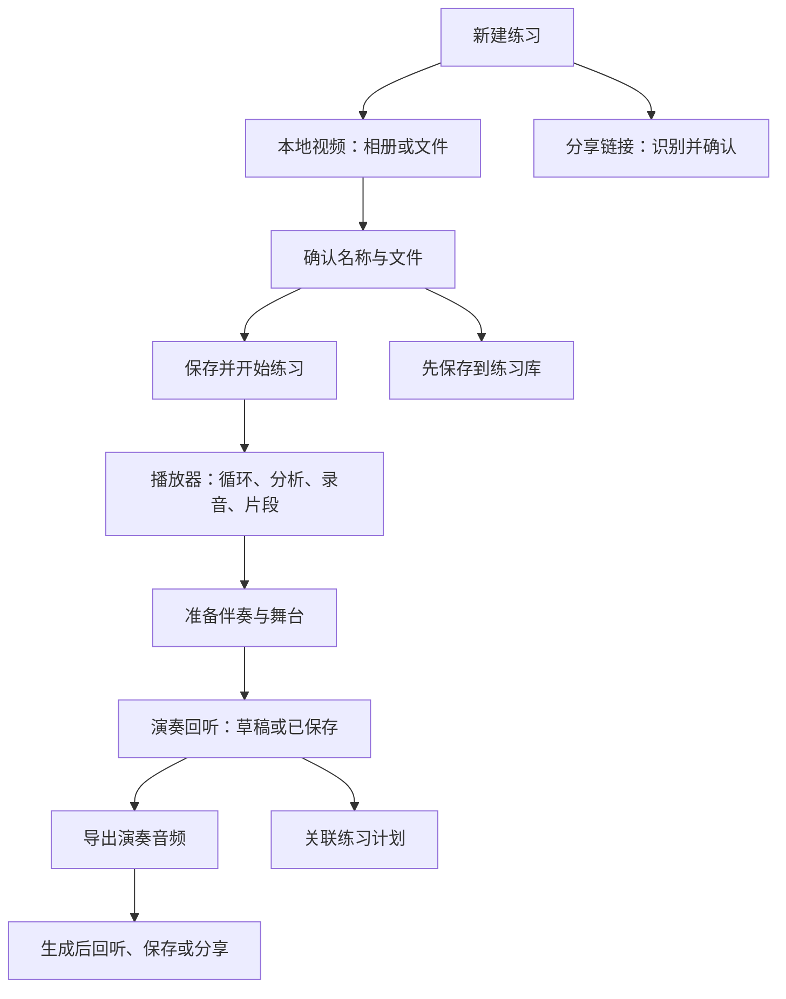

# 2026-11-05 页面逻辑与使用体验

## 本轮用户路径

底部导航保持「今日／练习库／新建／计划／我的」。新建仍是覆盖当前页面的操作，取消返回原页面，不再增加独立一级入口。

从计划新建内容仍返回计划并选中来源，不误跳进播放器。链接保存与系统分享接收仍沿用原流程，不自动读剪贴板或发起分析。

## 已实现

- 新建默认本地视频，分享链接通过分段选择切换。两种方式只展示当前需要的控件，切换保留输入并清除过时校验；读取本地视频／进入识别期间拦截重复操作。小屏大字号改为纵向选择，操作按钮纵向排列。
- 明确链接平台播放能力有差异，和弦／分轨使用本地视频；导入不会自动上传。视频确认页移除纯图标的大块占位，展示名称与紧凑文件摘要，详细元信息折叠；突出「保存并开始练习」，保留稍后练习及计划返回路径。拖动表单可以收起键盘。
- 回听页显示演奏草稿、已保存或有未保存调整。未改动的成果不再重复保存；标题变化即更新状态。已保存成果修改后进入导出／计划管理，可一次「保存并继续」；保存失败留在原页，保留修改，不继续跳转。导航动作防重复，弹窗退出完成后再改变 Slider 状态，保持语义与读屏。
- 导出分为生成前设置、生成中进度、完成后作品三个阶段。成功后首先展示「保存到文件」，其次回听／分享；技术参数与注意事项折叠。成功保存、取消保存、打开分享分别反馈，不把分享面板打开当作已经发送。调整设置会停止旧回听。
- 生成中返回先确认继续还是停止；取消按钮等待收尾期间禁用，播放操作不会显示生成进度。失败可重试或明确仅导出麦克风；原始文件与既有本机缓存不改写。
- 演奏列表分开待整理草稿与已保存成果；读取失败展示重新加载，不误报无录音。读取已保存列表成功前不将可能已保存的草稿当作可删除草稿。下拉刷新等待两个读取任务完成；空列表有准备伴奏入口。对比选择已满两条时，第三条禁选，取消一条即可继续选择。

## 验收

Flutter 全量 **483 项通过**，静态分析无问题。新增四项覆盖：320px／2倍文字导入方式切换与输入保留；读取失败重试后进入伴奏准备；导出前保存失败保留／成功继续；生成中返回继续或显式停止。原分享导入、计划新建返回、视频草稿清理、回听与导出测试保留。

Android 模拟器实际计划成果链路 **1 项通过**：从历史原生播放 → 关联计划 → 实际修改标题并重保存 → 计划回听 → 移除关联。仍只有原一条录音，原始音频字节和会话统计不变。键盘编辑后按正常收起键盘流程点击保存，未跳过原生播放和 SQLite 检查。

本机日志 `/tmp/gp-ux-full.log`、`/tmp/gp-ux-analyze.log`、`/tmp/gp-ux-native-plan.log`；普通 APK 在集成测试之后重新构建。GitHub 同步开发分支及 Draft PR，未合并。

## 后续体验验证

本轮集中在导入、演奏成果和导出的流程，未改动播放器同步时钟或算法。实体安卓手机触控／键盘、长曲等待体验及真实用户走查仍待验证；保音高导出、IP、账号同步按原计划继续。未调用算法服务或创建付费资源。
